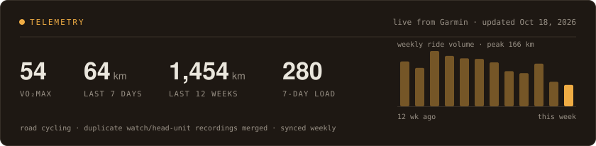

[;building+tools+and+guardrails+for+AI+agents)](https://github.com/victory-c)

 

---

<h3 align="center">About</h3>

I study Data Science and Cognitive Science at UC Berkeley. I build tools and guardrails
for AI agents — what they cost, where they break, and what stops them from doing damage.

Outside of that, I build tooling around my own training data, because I ride a lot and
Garmin gets more wrong than you'd think.

🛡️ Agent guardrails &nbsp;•&nbsp; 🤖 AI agent tooling &nbsp;•&nbsp; 🚴 Endurance data &nbsp;•&nbsp; 🔓 Open source

  

---

### Things I've built

**[fly-brain](https://github.com/victory-c/fly-brain)** — a fruit fly's whole central
nervous system (166,700 neurons, male CNS v1.0 connectome) run as a spiking network in PyTorch,
[learning to ride a road bike](https://fly-brain-bike.vercel.app/ride/) in side gusts. The
simulator reproduces Shiu et al. (*Nature* 2024) spike for spike against their Brian2 code, then
batches many flies on one GPU.

**[token-counter](https://github.com/victory-c/token-counter)** — audits monthly AI coding-agent
spend across Claude Code, Codex, Cursor, and Gemini, and flags every run that would have been
fine on a cheaper model.

**[fitpet](https://github.com/victory-c/fitpet)** — a Claude Code status-line companion that
grows from real Garmin training load.

**[vibeapply](https://github.com/victory-c/vibeapply)** — an AI-native job-application
copilot: a browser extension that rides along on job boards, backed by a structured candidate
profile and evidence bank. Scaffolded with agents, then audited — all nine findings fixed
before any feature work.

**[cal-dining-scanner](https://github.com/victory-c/cal-dining-scanner)** — watches UC Berkeley
dining menus for the foods you care about and emails you when they appear. One command to set
up, runs free on GitHub Actions. A friend spun it off into
[Cal-Bite](https://github.com/rileyqzhang/Cal-Bite), a full-stack version.

**[magene-garmin-fix](https://github.com/victory-c/magene-garmin-fix)** — Garmin inflates climb
10–70× for third-party bike computers by throwing away barometric altitude. This fixes it.

**[analyze-cycling-hr-thresholds](https://github.com/victory-c/analyze-cycling-hr-thresholds)** —
a Codex skill that reconciles Garmin field data with raw CPET gas-exchange data into heart-rate
thresholds, Garmin-ready zones, and labeled FTP proxies. It analyzes each source on its own and
refuses the tempting shortcuts — no converting heart rate straight to watts, no treating a lab
report's conclusion as raw evidence.

**[bay-area-venture-map](https://github.com/victory-c/bay-area-venture-map)** —
[interactive map](https://bay-area-venture-map.vercel.app) of the Bay Area venture cluster;
filter by AUM, stage, sector, and check size.

**[qosmic-audit-harness](https://github.com/victory-c/qosmic-audit-harness)** — contracts-first
agent harness: every claim in a generated audit must cite a real crawled page, enforced by a
validator that the writer and the evaluator share.

### Open source

#### [Taxuspt/garmin_mcp](https://github.com/Taxuspt/garmin_mcp) — *1.3k ★ · #2 contributor · 21 PRs merged*

The most-used MCP server for Garmin Connect. Behind the maintainer, I'm its largest contributor:
21 merged PRs (+3.3k lines) spanning auth, FIT decoding, training analytics, workout scheduling
and write safety. The pattern is the same throughout: find where an agent silently gets a
*plausible but wrong* answer, prove it with a real payload, and ship the fix with a regression test.

| | |
|---|---|
| [**#437**](https://github.com/Taxuspt/garmin_mcp/pull/437) | **Analytics assumed 1 record = 1 second.** With smart recording (a record every 1–8 s), a 20-min best of 300 W came out as 167 W, and climb VAM was off by 3×. Power curves, climbs and HR drift now use real timestamps. |
| [**#423**](https://github.com/Taxuspt/garmin_mcp/pull/423) | **Told the agent a retry was safe when it wasn't.** A 5xx that arrives *after* a write was sent may already be committed. It's now marked `write_committed: "unknown"`, so an agent checks before it double-logs. |
| [**#419**](https://github.com/Taxuspt/garmin_mcp/pull/419) | **Logged into the wrong account.** With `GARMINTOKENS` set, password login silently reused another profile's tokens and wrote them into the new directory. Credentials now always win. |
| [**#418**](https://github.com/Taxuspt/garmin_mcp/pull/418) | **Di2 shifts decoded with the bytes swapped**, so a 50×21 read as "50/2t". The tests passed only because the mocks used the same wrong layout. Rebuilt against the FIT profile, and added L/R power balance. |
| [**#254**](https://github.com/Taxuspt/garmin_mcp/pull/254) | **One stalled Garmin call froze the whole server** for about 4 minutes. Every proxied call is now bounded on a worker thread, with a timeout an agent can retry. |
| [**#426**](https://github.com/Taxuspt/garmin_mcp/pull/426) | **Memory leak in a login failure.** Re-raising a stored exception grew its traceback without bound: 3,000 frames after 1,000 tool calls. |

All 15 others

- **Courses** [#435](https://github.com/Taxuspt/garmin_mcp/pull/435): 5 of 8 sport types were mapped wrong (a gravel course saved as *track running*), GPX output was unescaped, and deleting now needs confirmation.
- **Analysis** [#436](https://github.com/Taxuspt/garmin_mcp/pull/436): bike power had leaked into running power curves, and HR drift is now labelled by its sign.
- **Workouts** [#433](https://github.com/Taxuspt/garmin_mcp/pull/433) · [#434](https://github.com/Taxuspt/garmin_mcp/pull/434): one failed `schedule_week` entry no longer hides the ones that succeeded; strict date validation and full library paging.
- **Health, training and weight** [#429](https://github.com/Taxuspt/garmin_mcp/pull/429) · [#427](https://github.com/Taxuspt/garmin_mcp/pull/427) · [#430](https://github.com/Taxuspt/garmin_mcp/pull/430): readiness fields, lactate-threshold history, weigh-in timestamps, and deletes that silently did nothing.
- **Gear, devices, PRs and nutrition** [#250](https://github.com/Taxuspt/garmin_mcp/pull/250) · [#431](https://github.com/Taxuspt/garmin_mcp/pull/431) · [#424](https://github.com/Taxuspt/garmin_mcp/pull/424) · [#432](https://github.com/Taxuspt/garmin_mcp/pull/432) · [#428](https://github.com/Taxuspt/garmin_mcp/pull/428): gear notes from the v2 API, real activity typeIds, the actual solar payload, when each personal record was set, and rename-safe food edits.
- **Null-safety** [#253](https://github.com/Taxuspt/garmin_mcp/pull/253): Garmin sends an explicit `null` for empty sections, so `.get(k, {})` returns `None`. Fixed five crashes of this kind, each with a regression test.
- **Auth and test infrastructure** [#425](https://github.com/Taxuspt/garmin_mcp/pull/425) · [#416](https://github.com/Taxuspt/garmin_mcp/pull/416): token verification for profiles without a full name, and live e2e tests made opt-in.

#### [NousResearch/hermes-agent](https://github.com/NousResearch/hermes-agent) — *251k ★*

- [**#64036**](https://github.com/NousResearch/hermes-agent/pull/64036) — reasoning-visibility
  leak on Gemini/Vertex: with `show_reasoning: false`, users still got dozens of raw
  thought-summary blocks. Two causes — effort and visibility were coupled in the request
  builder, and Vertex returns summaries *untagged* unless you set `thought_tag_marker`, so
  nothing downstream could key on them. Splits the two knobs to match Google's own API.
- [**#68524**](https://github.com/NousResearch/hermes-agent/pull/68524) — `web_extract` had one
  backend; expired credits or a rate limit meant total failure plus a gateway restart. Adds a
  configurable fallback chain.

#### [SpencerLiang0114/RouteCraft](https://github.com/SpencerLiang0114/RouteCraft) — *route planner for running, hiking, and cycling*

- [**#15**](https://github.com/SpencerLiang0114/RouteCraft/pull/15) ✅ merged — session auth,
  saved routes owned by the user who created them, and share links that expire.
- [**#14**](https://github.com/SpencerLiang0114/RouteCraft/pull/14) ✅ merged — imperial
  conversions next to every metric route value.

Berkeley, CA — usually on a bike when I'm not here.

